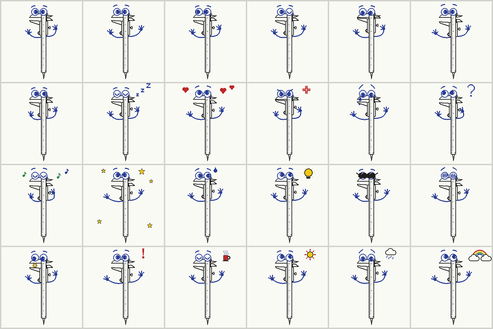
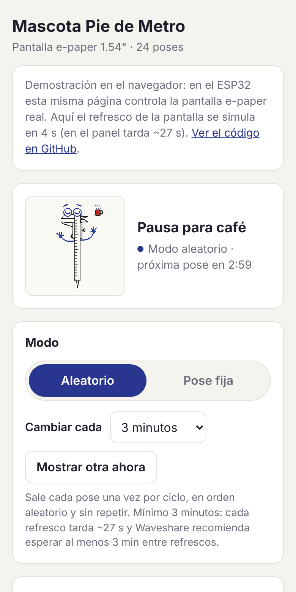

# Mascota Pie de Metro · e-paper + ESP32

Mascota virtual con forma de pie de metro para la pantalla **Waveshare 1.54" e-Paper (E)**, que usa tinta E Ink Spectra 6 (6 colores, 240×240), controlada por un **ESP32**.
Tiene **24 poses** que cambian en orden aleatorio, y una **página web servida por el propio ESP32** para elegir la pose y cada cuánto cambia.



## Demo de la interfaz

El repositorio genera automáticamente un sitio en **GitHub Pages** con la misma interfaz que sirve el ESP32. En el sitio, la API se simula en el navegador y las poses se dibujan con el mismo código del firmware.



Cuando GitHub Pages esté activado, la demo queda en `https://<tu-usuario>.github.io/<nombre-del-repo>/`.

## Qué hace

- **24 poses**: normal, saludando, guiño, midiendo, sorpresa, durmiendo, enamorado, enojado, triste, confundido, cantando, celebrando, nervioso, ¡idea!, con onda, mareado, midiendo una tuerca, ¡alerta!, pausa para café, día soleado, día lluvioso, arcoíris…
- **Modo aleatorio (por defecto)**: en cada ciclo salen todas las poses una vez, en orden aleatorio, y nunca la misma dos veces seguidas.
- **Pose fija**: se elige desde la web.
- **Intervalo configurable** desde 3 minutos hasta 24 horas.
- La configuración queda guardada en la memoria flash del ESP32.

## Hardware

| e-Paper | ESP32 |
|---|---|
| VCC | 3V3 |
| GND | GND |
| DIN | GPIO 14 |
| CLK | GPIO 13 |
| CS | GPIO 15 |
| DC | GPIO 27 |
| RST | GPIO 26 |
| BUSY | GPIO 25 |
| PWR | GPIO 33 (obligatorio: alimenta el panel) |

Son los pines de la [guía oficial de Waveshare para ESP32](https://docs.waveshare.com/1.54inch_e-Paper_E/ESP32).
Cada refresco tarda unos 27 s y la pantalla parpadea en colores; es normal en Spectra 6. Waveshare recomienda esperar al menos 3 minutos entre refrescos.

## Cargar el firmware

1. Instala el core **esp32** de Espressif en el Arduino IDE (probado con 3.3.10).
2. Instala la librería **Adafruit GFX Library** (probado con 1.12.6).
3. Abre `firmware/mascota_e6/mascota_e6.ino`, elige la placa **ESP32 Dev Module** y súbelo.
4. Conéctate a la página de control:
   - **Red propia (por defecto):** WiFi `Mascota-PieDeMetro`, clave `mascota123`. Luego abre <http://192.168.4.1>.
   - **Tu WiFi:** completa `WIFI_SSID` y `WIFI_PASS` al inicio del `.ino`. Luego abre <http://mascota.local> o la IP que aparece en el Monitor Serie (115200 baudios).

Para atender la página, el ESP32 queda encendido con WiFi. Conviene alimentarlo por USB.

## Estructura

```
firmware/mascota_e6/   Sketch de Arduino para el ESP32
  mascota_e6.ino       WiFi, servidor web, modo aleatorio/fijo, configuración
  mascota.h            Dibujo de la mascota y sus adornos (Adafruit GFX)
  poses.h              Tabla de las 24 poses y sus nombres
  epd_1in54e.h         Driver mínimo del panel 1.54" (E) Spectra 6
  pagina.h             Interfaz web (generada desde web/pagina.html)
web/
  pagina.html          Interfaz de control (fuente)
  demo.js              Simulación de la API para el sitio de GitHub Pages
tools/
  generar_pagina.py    web/pagina.html -> firmware/mascota_e6/pagina.h
  build_site.py        Dibuja las poses en PNG y arma el sitio en site/
  render/              Programa en C++ que dibuja las poses en la PC
.github/workflows/
  sitio.yml            Publica el sitio en GitHub Pages
  firmware.yml         Compila el firmware en cada cambio
```

## Agregar o cambiar poses

1. Agrega una fila a `POSES` y su nombre a `NOMBRES` en `firmware/mascota_e6/poses.h`.
   Los campos son: posición de las pupilas, parpadeo, cejas, mandíbula, ángulo de las manos, inclinación de las cejas y adorno (`EX_CORAZONES`, `EX_SOL`, …).
2. Para ver cómo quedan sin la placa:

   ```bash
   pip install pillow
   python3 tools/build_site.py --readme      # genera site/ y actualiza docs/poses.png
   python3 -m http.server -d site 8000       # abre http://localhost:8000
   ```

   Necesitas `git`, `g++` y Python 3. El script descarga Adafruit GFX y dibuja las poses con el mismo código del ESP32.

Si editas `web/pagina.html`, ejecuta `python3 tools/generar_pagina.py` para actualizar `pagina.h` antes de compilar.

## Publicar en GitHub

1. Crea un repositorio vacío en GitHub y sube este proyecto:

   ```bash
   git remote add origin https://github.com/<tu-usuario>/<nombre-del-repo>.git
   git push -u origin main
   ```

2. En el repositorio, entra a **Settings → Pages → Build and deployment** y en **Source** elige **GitHub Actions**.
3. Cada `push` a `main` vuelve a dibujar las poses y publica el sitio. El flujo **Compilar firmware** revisa que el sketch compile para ESP32.

## Créditos

La secuencia de comandos del panel en `epd_1in54e.h` se basa en el [código de ejemplo de Waveshare para la 1.54" (E)](https://github.com/waveshareteam/1.54inch_e-Paper_E). El dibujo usa [Adafruit GFX](https://github.com/adafruit/Adafruit-GFX-Library).
